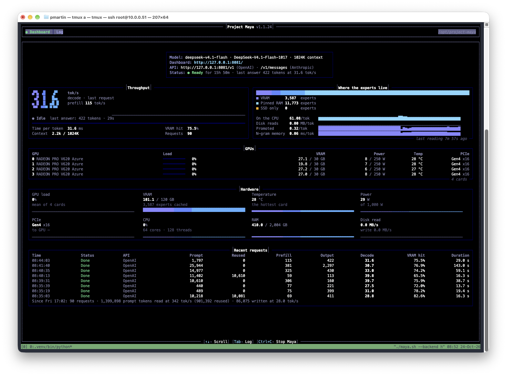

# LLM Performance Engineering Notebook

## October 28: Maya prefill tuning

On v1.1.30, the four-V620 DeepSeek UD-Q8_K_XL sweep completed 60 valid measurements. **32K chunks with an 800 MiB ring reached about 439 tokens/s at 32K and 480 at 64K**, approximately 8% and 11% above the initial baseline. I selected that combination for subsequent tuning. The [full record](results/lab-notebook/2026-10-28-maya-prefill-and-regression.md) covers recovery from the later-release hang, all nine combinations, the next TP/workspace sweep, and the decision to exclude quality-reducing optimizations. The server archive is now retained. The second sweep was intentionally stopped after 15 completed cases: TP=1 was slower, TP=4 requests fell back to TP=2, and workspace changes gave no clear improvement. A v1.1.36 benchmark completes with `DS4_STREAM_PRIO=0`; priority enabled reproduces a deadlock on this setup.

## October 24: DeepSeek in use

The next morning, Maya's DeepSeek-V4.1-Flash dashboard shows **90 requests and 86,075 output tokens at a reported aggregate 28.0 tokens/s**. The last request generated 422 tokens at **31.6 tokens/s**. This adds a view of ongoing use on Galactus to the previous day's controlled calibration.

*October 24 dashboard capture. The large rate is for the last request; the session aggregate appears at the bottom. [Snapshot details and measurement limits](results/deepseek-v4.1-flash.md#october-24-dashboard-from-ongoing-use).*

## October 23: two large MoE models at roughly 30 tokens/s

In separate October 23 Maya tests, Galactus recorded **GLM-5.3-Flash UD-Q4_K_XL at 31.6 generated tokens/s** and **DeepSeek-V4.1-Flash-1017 UD-Q8_K_XL at 29.3 tokens/s with DSpark**, using Project Maya v1.1.24 on four Radeon Pro V620 GPUs and 2 TiB of system RAM. This is a substantial step forward for the notebook: both models exceed GPU memory, yet their recorded configurations reach approximately 30 tokens/s on this server.

| Model | Speculative generation | Without speculation | Within-test improvement |
|---|---:|---:|---:|
| GLM-5.3-Flash UD-Q4_K_XL | **31.6 tokens/s** | 19.9 tokens/s | **58.8%** |
| DeepSeek-V4.1-Flash-1017 UD-Q8_K_XL | **29.3 tokens/s** | 21.2 tokens/s | **38%**, with 69% draft acceptance |

These are separate model runs. GLM uses Maya's three-answer benchmark; DeepSeek uses its DSpark calibration workload. GLM's initial default run measured 29.4 tokens/s, and manual speculative-head and MTP-expert sweeps retained the defaults as the highest observed configuration. Dedicated 8192-token prefill measured 240–242 tokens/s for GLM and 282 for DeepSeek in its earlier undrafted benchmark. The DeepSeek conversation identifies the intended export as UD-Q8_K_XL; its actual Maya model path and effective configuration were not captured.

**[The milestone, A/B test, and tuning results](results/lab-notebook/2026-10-23-maya-glm53-speculation.md)** · [October 22 llama.cpp and llAMDa comparison](results/lab-notebook/2026-10-22-glm53-build-comparison.md) · [DeepSeek calibration and memory setup](results/lab-notebook/2026-10-23-deepseek41-cache-and-maya.md)

## [Introducing llamda.cpp — a llama.cpp fork optimized for AMD GPUs](https://github.com/pauldmartinphd/llAMDa.cpp)

**AMD-focused llama.cpp fork for RDNA, Strix Halo, and Vega.**

I built [llAMDa.cpp](https://github.com/pauldmartinphd/llAMDa.cpp) to bring the AMD work I need into one repository: architecture-specific kernels, support for newer MoE models, and the scheduler changes I developed while testing large models on Galactus. Instead of maintaining separate model integrations for each GPU family, I put the common changes in `amd-main` and built the architecture development branches on that base.

The fork combines AMD patches from Edwin Brown's RDNA fork, halo-box's Strix Halo fork, and mxxm-t's fork with Daniel Han and Unsloth's DeepSeek-V4.1-Flash-1017/DSpark implementation. I preserved the source credits and added both parts of my multi-GPU MoE prefill patch: distributing eligible expert work across GPUs and bypassing the routing-index readback for sufficiently large batches. All four branches include those prefill changes.

| Branch | Purpose |
|---|---|
| [`amd-main`](https://github.com/pauldmartinphd/llAMDa.cpp/tree/amd-main) | Default branch: common AMD changes, DeepSeek-V4.1/DSpark, and my MoE prefill patch |
| [`rdna-dev`](https://github.com/pauldmartinphd/llAMDa.cpp/tree/rdna-dev) | RDNA development, including the V620 work that started the fork |
| [`halo-dev`](https://github.com/pauldmartinphd/llAMDa.cpp/tree/halo-dev) | Strix Halo development |
| [`vega-dev`](https://github.com/pauldmartinphd/llAMDa.cpp/tree/vega-dev) | Vega development, including gfx900 and gfx906 targets |

**[Code and build documentation](https://github.com/pauldmartinphd/llAMDa.cpp) · [Source credits](https://github.com/pauldmartinphd/llAMDa.cpp/blob/amd-main/CREDITS-AMD.md) · [Development notes](results/lab-notebook/2026-10-21-llamda-amd-fork.md)**

In the original July GLM-5.2 experiment, my combined prefill patch raised throughput from **104.97 to 119.36 tokens/s (+13.7%)**. I have built and checked the current port on all four branches, and the October 22 record now supplies revision-identified GLM benchmarks. Those runs do not isolate this patch: the controlled patch-off comparison remains outstanding. The earlier result explains why I included the patch; it does not establish the gain for the newer models.

## DeepSeek cache sweep and Project Maya (recorded October 23)

With DeepSeek-V4.1-Flash-1017 UD-Q8_K_XL, my retained `llamda-bench` output reports **132.66 ± 0.30 pp8192** and **9.51 ± 0.07 tg1024 tokens/s** at a requested 32 GiB expert cache. The conversation summary reports 10.20 generation tokens/s with the cache disabled and 11.54 at 64 GiB; 80 GiB failed with an OOM. Only the 32 GiB row includes its full command and printed output, so the broader sweep remains provisional.

The additional Maya output records **282 tokens/s at 8192-token prefill** and a DSpark calibration improving sustained generation from **21.2 to 29.3 tokens/s (+38%)**, with **69% draft acceptance**. The LXC shell checks show unlimited memlock after the reported residency changes, but several settings changed together and the engine workloads differ. [The new experiment record](results/lab-notebook/2026-10-23-deepseek41-cache-and-maya.md) preserves the evidence and remaining measurement limits.

## Experiments behind the fork

I started this notebook to measure local LLM inference with models whose weights exceed GPU memory, placing routed experts in system RAM while GPUs handle the dense computation. Those experiments led me from configuration changes to modifying llama.cpp itself.

In the earlier V620 tests, I measured [GLM-5.3-Flash at 19.1–19.4 t/s under automatic placement](results/lab-notebook/undated-glm53-flash-placement.md). My [DeepSeek-V4.1 DSpark attempt ran out of VRAM while loading the draft model](results/lab-notebook/undated-deepseek41-dspark.md). I kept the raw logs and complete GLM results alongside the analysis, and I discuss the measurements needed to explain the remaining decode bottleneck in [the bandwidth note](results/lab-notebook/2026-10-21-bandwidth-and-placement.md).

I also reconstructed the earlier build and testing history from [46 original experiment files](results/raw-logs/2026-10-22-galactus-archive/README.md): [April thread and batch sweeps](results/lab-notebook/2026-04-07-to-17-thread-and-batch-tests.md), [July diagnostics and hardware monitoring](results/lab-notebook/2026-07-14-diagnostic-reconstruction.md), and [DSpark acceptance and August rebenchmarks](results/lab-notebook/2026-08-16-speculation-and-rebench-records.md).

## The earlier scheduler investigation

The most detailed investigation so far is GLM-5.2 on Galactus, an EPYC 7713 server with eight-channel DDR4 and four Radeon Pro V620 GPUs. Memory bandwidth explains much of its decode time. Prefill exposed a different problem: llama.cpp concentrated offloaded expert computation on one GPU, and a routing-index readback serialized the work. A scheduler patch raised prefill from **104.97 to 119.36 tokens/s (+13.7%)** in the July comparison. Distributing the work alone produced no meaningful gain; removing the synchronization was also necessary.

The repository includes the measurements, unsuccessful experiments, patch instructions, and chronological notes behind these conclusions. The Galactus investigation now sits alongside the first oMLX measurements on Magneto, a 14-inch M2 Max MacBook Pro. Since the two engines were measured separately, each record gives its platform and conditions rather than treating the results as a common benchmark.

## Results

### Earlier DeepSeek-V4.1-Flash and GLM-5.3-Flash CLI results

These CLI tests used my combined V620, older DeepSeek, GLM-5.3 MTP, and round-robin patch build. They predate the newer Unsloth integration. I used a short ZFS prompt and a 256-token generation limit, so I keep these rates separate from the normalized benchmark below.

| Model and configuration | Generation t/s |
| --- | ---: |
| [GLM-5.3-Flash, MTP, automatic placement](results/glm-5.3-flash.md) | 19.1–19.4 |
| [GLM-5.3-Flash, MTP, forced-RAM experts, no explicit cache allocation](results/glm-5.3-flash.md) | 13.7–14.4 |
| [DeepSeek-V4.1-Flash Q4_K_M, target only](results/deepseek-v4.1-flash.md) | 11.2 |
| [DeepSeek-V4.1-Flash with DSpark](results/deepseek-v4.1-flash.md) | Draft loading failed: insufficient VRAM |

### August common baseline

The latest common baseline in this notebook was measured on **August 15–16, 2026**, after Galactus's upgrade from 1 TB to 2 TB of RAM. All five models used llama.cpp build `3653e6d6d`, the stock scheduler, CPU-resident routed experts, and `-b 8192 -ub 8192 -p 8192 -n 128 -r 2`. GLM used 32 threads; the other models used 64. `pp8192` measures processing an 8,192-token prompt; `tg128` measures generating 128 tokens. Rates are tokens per second.

| Model | pp8192 | tg128 | Speculative decode on the same build |
|---|---|---|---|
| [MiniMax M2.7](results/minimax-m2.7.md) | 418.83 ± 24.11 | 15.18 ± 0.18 | — |
| [Qwen 3.5 397B](results/qwen-3.5-397b.md) | 249.61 ± 19.78 | 9.37 ± 0.16 | MTP failed to initialize on this export |
| [DeepSeek-V4-Flash-0731](results/deepseek-v4-flash.md) | 143.54 ± 1.64 | 10.34 ± 0.10 | 14.1 ± 0.7 (DSpark, n=3) |
| [GLM-5.2](results/glm-5.2.md) | 95.99 ± 3.36 | 5.30 ± 0.00 | 6.6 ± 0.3 (MTP, n=2) |
| [Kimi K2.6](results/kimi-k2.5.md) | 94.23 ± 4.45 | 5.79 ± 0.01 | — |

The speculative runs used a ZFS explanation prompt, greedy decoding, and llama-cli rather than llama-bench. Their repeated timings varied by about 9%; the reported spreads are not confidence intervals. MiniMax was retired after this measurement. [The August common baseline](results/lab-notebook/2026-08-15-to-16-common-baseline-2tb.md) records the exact model files, conditions, repetitions, and remaining questions.

The July patch result and April resident-expert results used different builds and configurations. They remain in the [model notes](results/README.md), with their original conditions, and are not included in the stock baseline above.

## Apple Silicon measurements (September 30, 2026)

[Qwen3.8-27B on Magneto](results/qwen-3.8-27b.md) records an initial Lightning MTP baseline of **156.1 PP / 16.4 TG tokens/s at 4K**, with tuned ANE + MTP at **170.1 / 13.9** and a later screenshot at **171.0 / 16.9**. The baseline survives as a conversation transcription; the later results have a retained screenshot. Heavy thermal pressure was observed during the investigation. The oMLX leaderboard label omits chassis, so the higher external M2 Max result cannot establish an equivalent-machine comparison. A larger chassis is a hypothesis, not an identified cause. [The Magneto measurements](results/lab-notebook/undated-magneto-omlx-qwen38.md) record the ANE tuner/benchmark distinction, DFlash regression, incomplete SpecPrefill experiment, and evidence limitations.

## Reading the notebook

The [findings](takeaways/general-principles.md) collect what the experiments established and what remains uncertain. The [methodology](results/methodology.md) explains how I measured performance; the [reproduction guide](REPRODUCE.md) gives the commands and checks.

| Material | Where to find it |
|---|---|
| Model summaries and common baseline | [Results](results/README.md) |
| Scheduler investigation and exact edits | [Prefill patch](patches/prefill/README.md) |
| Changes that did not help on Galactus | [Negative results](takeaways/refuted-hypotheses.md) |
| MTP and DSpark measurements | [Speculative decoding](takeaways/speculative-decoding.md) |
| Experiments in chronological order | [Lab notebook](results/lab-notebook/overview.md) |
| Early build record, dated model surveys, and deployment proposals | [Source notes](results/reference-notes/README.md) |
| Original captures and extracted measurements | [Raw logs](results/raw-logs/) and [CSV data](results/data/) |
| Machine specifications and memory measurements | [Hardware](hardware/README.md) |
| Diagnostic scripts and historical rerun protocol | [Experiments](experiments/README.md) |

## Earlier build and deployment notes

The [March build entry](results/lab-notebook/2026-03-23-galactus-build.md) preserves the initial ROCm/container setup, DIMM replacement results, and expert-placement command, under conditions that differ from the July and August investigations. The [dated source notes](results/reference-notes/README.md) also retain a July model shortlist, September architecture comparisons, and an unmeasured two-node residency proposal. These records explain the build and candidate selection; they do not add a new common benchmark or establish the proposed routing roles.

## Work remaining

The October 22 GLM benchmarks identify their revisions, while the DeepSeek cache capture still lacks one. The October 23 Maya tests establish a GLM speculation A/B result and record the head and MTP-expert measurements. The KEEP=4 capture lacks its final summary. Longer-context workloads, repeated tuning trials, and a prefill-patch A/B test remain open.

The later configuration cleanup, both Maya configuration renames, and GLM’s requested move to port 8082 lack confirming output. GLM’s port 8100 setting is printed in the October 23 record; the October 24 dashboard subsequently shows DeepSeek’s endpoint on port 8081.

As of the August 16 entry, the next comparison was the prefill patch against the stock build on the four retained models. An upstream patch submission, investigation of speculative-run timing variance, a choice between Kimi K2.6 and K2.7-Code, and a Kimi K3 evaluation remain open. The August speculative runs supersede the Session 10 rerun protocol.

## License and attribution

Code in `patches/` and `experiments/` is covered by the [MIT license](LICENSE). Text and data are covered by [CC BY 4.0](LICENSE-CC-BY-4.0.txt); [LICENSING.md](LICENSING.md) gives the scope and attribution details.

This project is not affiliated with AMD, llama.cpp, or any model vendor. Galactus and the other machine names are the names I use for the lab hardware.
