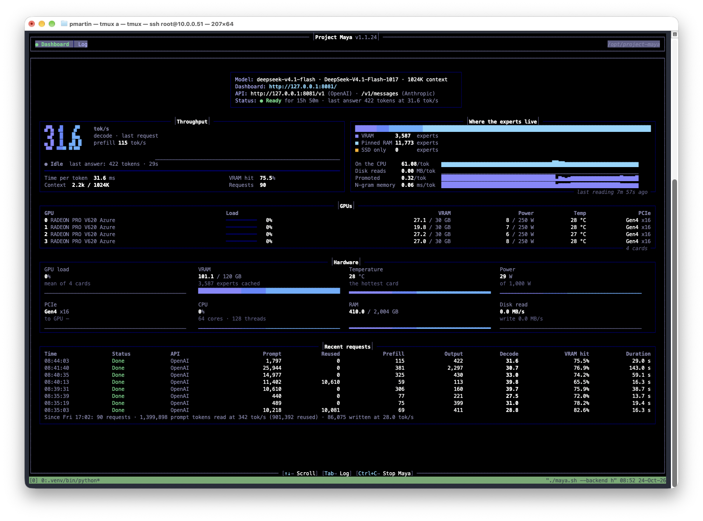

# DeepSeek-V4.1-Flash on Galactus

## Current place in the project

You host DeepSeek-V4.1-Flash-1017 UD-Q8_K_XL on Galactus's GPUs 0 and 1, leaving the other pair for GLM-Flash. The selected Maya configuration uses TP2, DSpark, 32K prefill chunks, an 800 MiB ring, and FP16-output prefill. That last setting changes a computation path; the stored weights remain Q8.

The [two-model chapter](../investigations/06-sharing-galactus.md) explains the GPU-allocation decision. The [long-prompt chapter](../investigations/05-tuning-long-prompts.md) explains the chunk/ring sweep and later precision test. Older records below use other builds, model exports, and GPU counts, so they should not be read as a single benchmark progression.

## November 9–10: TP2 on two V620s

The [two-GPU baseline](lab-notebook/2026-11-09-deepseek-tp2-and-tp4.md) measured 29.0 tokens/s built-in mean decode; requested TP4 still executed TP2. The [FP16-output prefill experiment](lab-notebook/2026-11-09-deepseek-fp16-prefill.md) reached median 389.55 / 501.95 / 589.70 tokens/s at 8K / 16K / 32K.

The original baseline used v1.1.54; the optimized run used v1.1.57, while the intervening TP4-fallback observations provide same-binary TP2 context.

Logs report zero nonfinite FP16 outputs, which checks overflow rather than answer quality. Prompt-skip diagnostics do not by themselves identify the excluded aggressive mode. No local quality-equivalence evaluation was supplied. Weights remain UD-Q8_K_XL. The [selected deployment](lab-notebook/2026-11-10-maya-dual-model-production.md) keeps this service on GPUs 0–1 alongside GLM-Flash on 2–3.

## Earlier measurements

### November 5: Maya v1.1.54 prefill sweep

On the four-V620 configuration identified as UD-Q8_K_XL, the default measured **324.8 / 459.4 / 479.4 prefill tokens/s at 8K / 32K / 64K**. Ten variants completed two repetitions at each length. No switch established a useful improvement, and auto chunking was slower. Both requested peer transports fell back to host transport; a focused larger-reserve retest failed in the startup probe. The [full record](lab-notebook/2026-11-05-maya-v1154-prefill-and-peer-ar.md) preserves the measurement and activation limits, supplied script, and source evidence. These raw-token engine requests are not a matched comparison with the older saved HTTP requests.

### November 5: proposed style and refusal experiments

You defined a [Heretic evaluation project](lab-notebook/2026-11-05-deepseek-style-and-heretic-plan.md) comparing the original, style-only, refusal-only, and combined models. The objective is to remove unwanted rhetorical prose while preserving technical depth and testing reasoning and factual accuracy directly. Unnecessary-refusal reduction is optional. No model was modified or benchmarked; compatibility with the exact checkpoint, ROCm workflow, and Maya export remains to be established.

### October 29: production v1.1.36 at 488.6 tokens/s prefill

The confirmed production configuration, `maya-ds4-production-no-stream-prio.json`, completed a 65,568-token prompt with zero cache hits at **488.6 tokens/s prefill** and **24.4 tokens/s decode**. It uses four V620s, ROCm 7.2, TP2, a 32,768-token chunk, an 800 MiB ring, `DS4_STREAM_PRIO=0`, and port 8081 with DeepSeek-V4.1-Flash-1017 UD-Q8_K_XL. Disabling stream priority was a historical workaround; it was no longer in use by October 30. The prefill rate is about 1.8% above the prior ~480 baseline; one request does not show a meaningful release improvement. The [dated record](lab-notebook/2026-10-29-maya-production-64k.md) preserves the pasted output, request source details, working configuration, and historical comparison limits. This documents the existing run without repeating tests or changing production.

### October 24: dashboard from ongoing use

The screenshot captured at 08:52 shows Project Maya v1.1.24 serving DeepSeek-V4.1-Flash-1017. Since the displayed Friday 17:02 session start, the dashboard reports **90 requests**, **86,075 output tokens**, and an aggregate generation rate of **28.0 tokens/s**. Its last request generated **422 tokens at 31.6 tokens/s**; the displayed 29-second request duration includes more than generation time and should not be used as that rate's denominator.

The expert panel shows **3,587 experts in VRAM**, **11,773 in pinned RAM**, and **zero SSD-only experts**. GPU memory use is **101.1 / 120 GB**, and system RAM use is **410.0 / 2,004 GB**, as displayed. The dashboard is idle at capture time, so its power and GPU-load readings do not describe active inference.

The configured context is **1024K**, with **2.2k** in use for the last request. This is evidence of the configured capacity, not a million-token performance test. The screenshot does not print the quantization or draft settings. The earlier investigation identifies UD-Q8_K_XL as the intended export and records a successful DSpark calibration; the screenshot does not show that this session retained either setting. It does show DeepSeek’s endpoint on port 8081. These are dashboard observations from mixed requests, kept separate from the controlled DSpark calibration below.

### October 23: 29.3 tokens/s with Maya and DSpark

DeepSeek-V4.1-Flash-1017, attributed in the conversation to UD-Q8_K_XL, reached **29.3 sustained generated tokens/s** in Project Maya v1.1.24 on four V620s, compared with **21.2 without drafting** in the same calibration. The measured gain was **38%**, with **69% draft acceptance**. Each mode generated 1152 measured tokens after warm-up. The separate undrafted benchmark reported 20.5 generation tokens/s and 282 tokens/s for an 8192-token prefill test.

The [calibration and memory record](lab-notebook/2026-10-23-deepseek41-cache-and-maya.md) preserves the outputs and configuration limits. Together with [GLM-5.3-Flash at 31.6 tokens/s](lab-notebook/2026-10-23-maya-glm53-speculation.md), this gives Galactus two large MoE models running at approximately 30 tokens/s in separate Maya tests.

### Flash-1017 cache sweep, recorded October 23

The newer UD-Q8_K_XL `llamda-bench` capture reports **132.66 ± 0.30 pp8192** and **9.51 ± 0.07 tg1024 tokens/s** with a requested 32 GiB expert cache, 32 threads, layer splitting, and CPU placement for Engram embeddings and routed experts. The source revision is not printed. The accompanying conversation summary reports generation at 10.20 tokens/s without the cache and 11.54 at 64 GiB, plus an OOM at 80 GiB; those entries lack their original command/output captures.

The [cache and Maya comparison record](lab-notebook/2026-10-23-deepseek41-cache-and-maya.md) includes the exact available command, captured Maya benchmark and DSpark calibration (+38% sustained generation), evidence limits. These measurements use a different export and workload from the earlier tests below.

### Earlier Q4_K_M and DSpark tests

You tested the eleven-shard Q4_K_M export from `vcruz305/DeepSeek-V4.1-Flash-GGUF` with the DSpark export from `JigSawPT/DeepSeek-V4.1-Flash-DSpark-GGUF`. Your V620 build combined the V620 patches, older DeepSeek implementation, GLM-5.3 MTP support, and your round-robin prefill patch. It reports `b0-unknown`; the captures do not show the exact commit or run dates.

| Configuration | Generation t/s | Outcome |
| --- | ---: | --- |
| Target only | 11.2 | Completed the 256-token generation test |
| DSpark, n-max 2, draft GPU offload | — | Failed to allocate 2464.20 MiB on ROCm0 while loading the draft |

You used 32 threads, context 8192, flash attention, `--load-mode none`, and greedy decoding for the ZFS explanation prompt. The target-only command did not explicitly specify CPU-MoE placement or tensor splitting. The output contained unfinished reasoning at the token limit; you did not score answer quality.

The log ends with commands for a four-way comparison of DSpark off/on and automatic/forced-RAM placement, but it contains no output from those commands. You therefore have no successful V4.1 DSpark timing in this capture and no round-robin-off comparison.

These results precede the replacement with Unsloth's V4.1-Flash-1017 implementation. They also differ from the earlier [DeepSeek-V4-Flash-0731 results](deepseek-v4-flash.md); those successful DSpark runs cannot substitute for a V4.1 measurement.

[Full experiment record](lab-notebook/undated-deepseek41-dspark.md) · [Original log](raw-logs/2026-10-21-flash-experiments/DeepSeekV4Flash%20Experiments.txt) · [Chronological notebook](lab-notebook/README.md)
